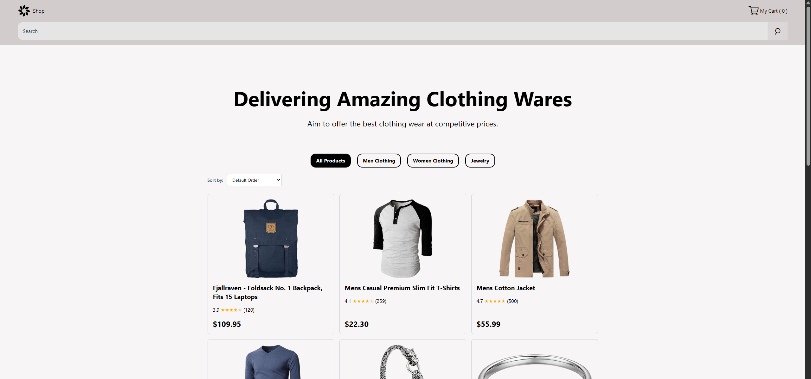
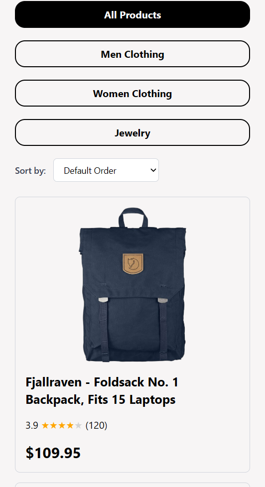

# Shopping Site
Shopping website created by following a figma created design, fully interactive shopping site with multiple features to ensure a seemless shopping experience, the technologies that were used are Next JS and Twilwind

## Live Demo
[View Live Demo] (https://shopping-site-o31eos344-ner046.vercel.app/)

## Screenshots
- Desktop Design

- Mobile Design

## Features

- Interactive shopping site
- Fully Responsive design
- Search filtering with params and catergory pills to filter products
- Clean modern design following figma template
- React creating live states 
- Local Storage to save the cart state
- Dynamic link for every product
- Sort menu that sorts products based on price, rating and order
- Selecting size for certain products

## Technologies Used

- Next JS
- Tailwind CSS